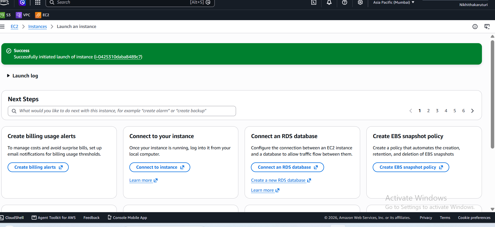

**Week 2 – Day 11: Launch a VM/Instance**

**Objective**

Launch a virtual machine using Amazon EC2 and understand the basic configuration required for an AWS VM.

**Topics Practiced**

- Amazon EC2
- Virtual Machines
- AMI
- Instance Types
- Key Pairs
- Security Groups
- Public IP Address
- EBS Storage

**Hands-on Practice**

- Opened Amazon EC2 in the AWS Management Console
- Selected Ubuntu as the operating system
- Selected the `t3.micro` instance type
- Created and used the `cloud-key` key pair
- Configured a security group
- Enabled a public IP address
- Configured 8 GiB gp3 storage
- Successfully launched the EC2 instance

**What I Learned**

I learned how to launch a virtual machine using Amazon EC2 and understood the basic configuration required for an instance, including the AMI, instance type, key pair, security group, public IP address, and storage.

**Practice Screenshot**

**Status**

**Week 2 – Day 11: Completed**
