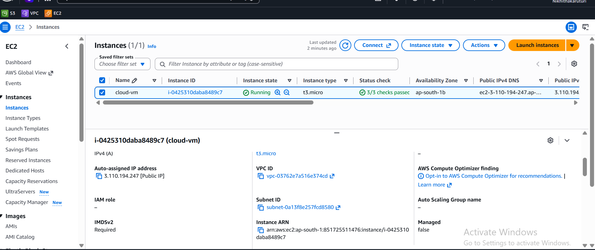

**Week 2 – Day 12: Understand the Network Layer**

**Objective**

Understand the basic AWS networking components used by an EC2 instance.

**Topics Practiced**

- Amazon VPC
- Subnets
- Availability Zones
- Private IPv4 Address
- Public IPv4 Address
- Security Groups
- Basic AWS Network Structure

**Hands-on Practice**

- Opened the EC2 instance networking information
- Identified the VPC associated with the EC2 instance
- Identified the subnet associated with the EC2 instance
- Reviewed the Availability Zone
- Reviewed the private IPv4 address
- Reviewed the public IPv4 address
- Reviewed the security group
- Explored the basic relationship between VPC, subnet, security group, and EC2

**What I Learned**

I learned the basic network structure used by an EC2 instance in AWS. I understood how a VPC contains subnets, how an EC2 instance runs inside a subnet, and how security groups control network traffic.

**Practice Screenshot**

**Status**

**Week 2 – Day 12: Completed**
