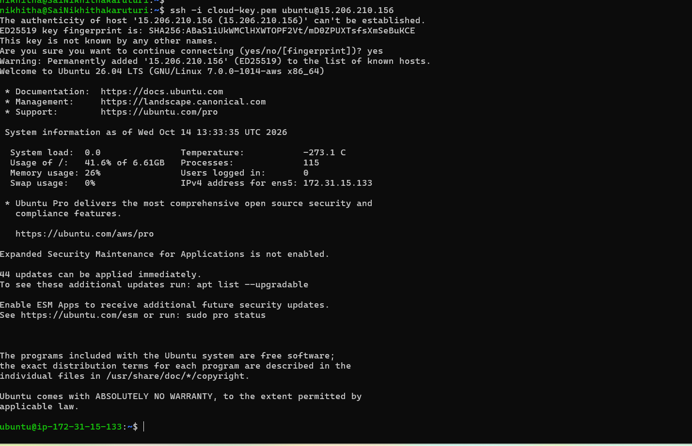

**Week 2 – Day 13: SSH into an EC2 Instance**

**Objective**

Learn how to connect to an AWS EC2 Linux instance using SSH.

**Topics Practiced**

- Amazon EC2
- SSH
- Linux Server
- SSH Key Pair
- Security Groups
- Port 22
- Public IP Address

**Hands-on Practice**

- Connected to the AWS EC2 instance using SSH
- Used the SSH key pair to authenticate the connection
- Configured the security group to allow SSH access
- Used the EC2 public IP address for the connection
- Successfully accessed the Ubuntu Linux server through the terminal

**What I Learned**

I learned how to securely connect to an EC2 Linux server using SSH. I also understood the role of SSH keys, security groups, port 22, and the public IP address when connecting to a cloud server.

**Practice Screenshot**

**Status**

**Week 2 – Day 13: Completed**
