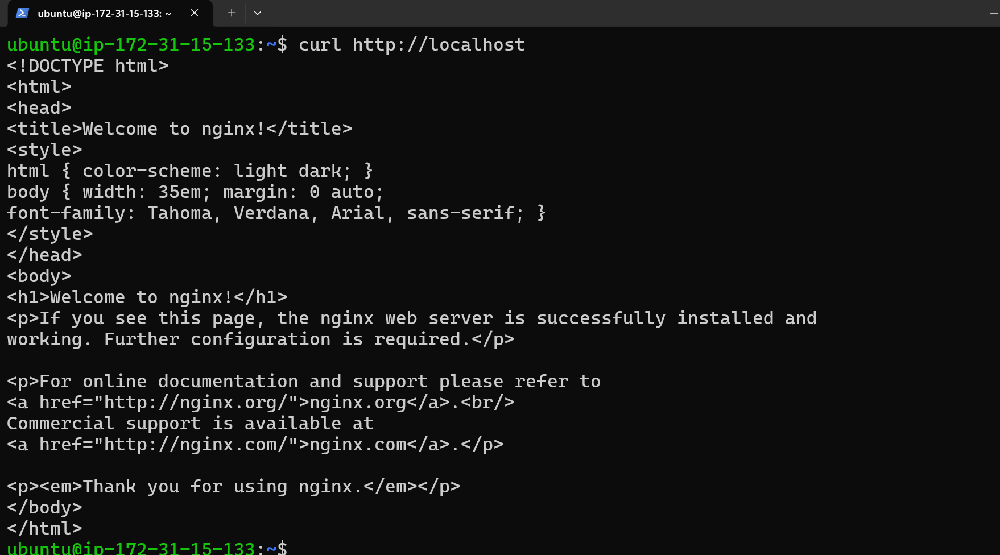

**Week 2 – Day 14: Install Nginx on EC2**

**Objective**

Install Nginx on an Ubuntu EC2 instance and verify that the web server is running.

**Topics Practiced**

- Nginx
- Web Server
- Ubuntu
- EC2
- Linux package management
- systemctl
- curl

**Hands-on Practice**

- Connected to the Ubuntu EC2 instance using SSH
- Updated the Ubuntu package list
- Installed Nginx
- Checked the Nginx service status
- Verified that Nginx was running
- Tested the Nginx web server using curl

**Commands Practiced**

`sudo apt update`

`sudo apt install nginx -y`

`sudo systemctl status nginx`

`curl http://localhost`

**What I Learned**

I learned how to install Nginx on an Ubuntu EC2 instance and verify that the Nginx web server is running. I also learned how Linux services can be managed using systemctl.

**Practice screenshot**

**Status**

**Week 2 – Day 14: Completed**
