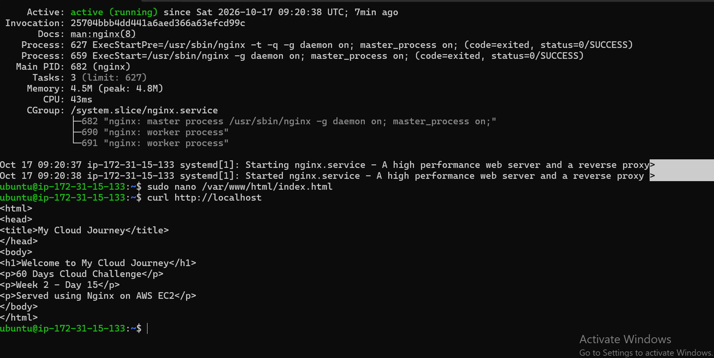

**Week 2 – Day 15: Serve a Web Page Using Nginx**

**Objective**

Configure Nginx on an Ubuntu EC2 instance to serve a custom web page.

**Topics Practiced**

- Amazon EC2
- Ubuntu Linux
- Nginx
- Web Server
- HTML
- Linux File System
- Localhost Testing

**Hands-on Practice**

- Connected to the Ubuntu EC2 instance using SSH
- Verified that Nginx was running
- Created a custom `index.html` file
- Placed the webpage in the Nginx web root directory
- Configured the webpage to be served by Nginx
- Tested the webpage using `curl http://localhost`
- Verified that the custom webpage was successfully served

**Web Page Content**

- Welcome to My Cloud Journey
- 60 Days Cloud Challenge
- Week 2 – Day 15
- Served using Nginx on AWS EC2

**Commands Practiced**

`sudo systemctl status nginx`

`sudo nano /var/www/html/index.html`

`curl http://localhost`

**What I Learned**

I learned how to configure Nginx to serve a custom HTML webpage from an Ubuntu EC2 instance. I also learned how to test a web server locally using localhost and curl.

**Practice Screenshot**

**Status**

**Week 2 – Day 15: Completed**
